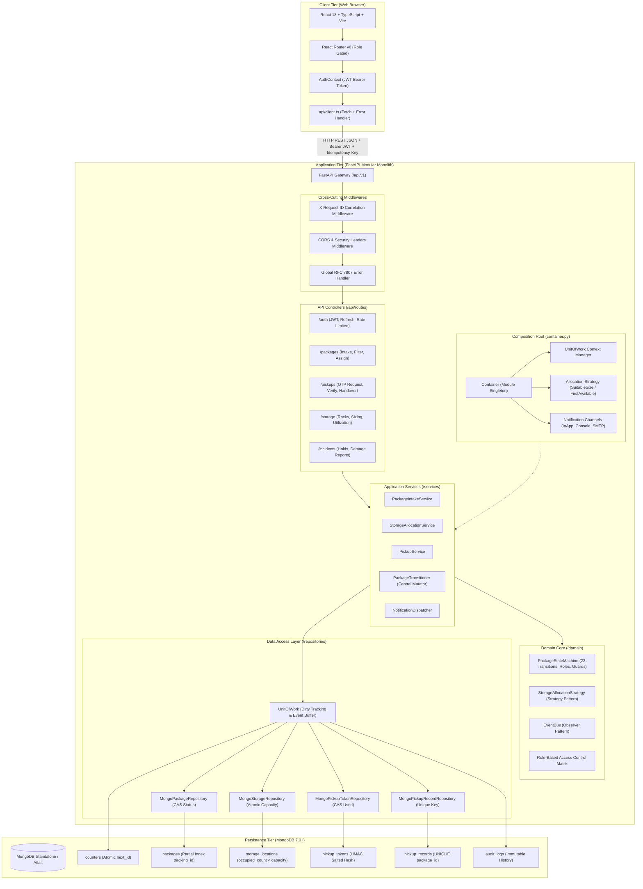
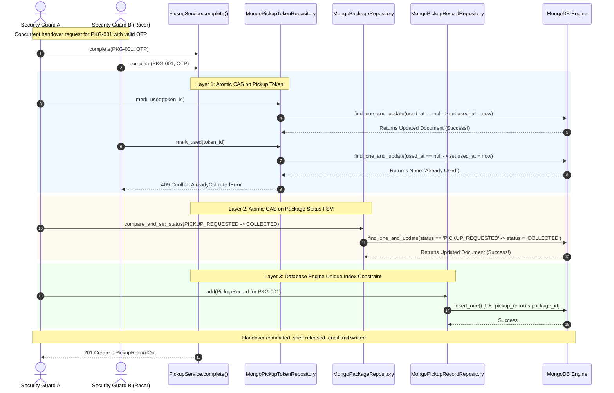
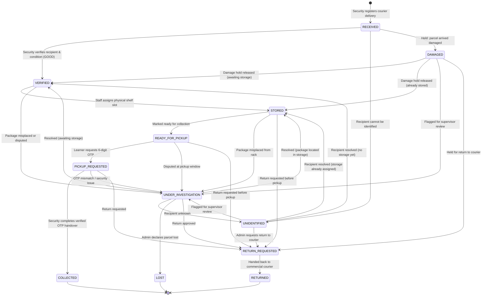
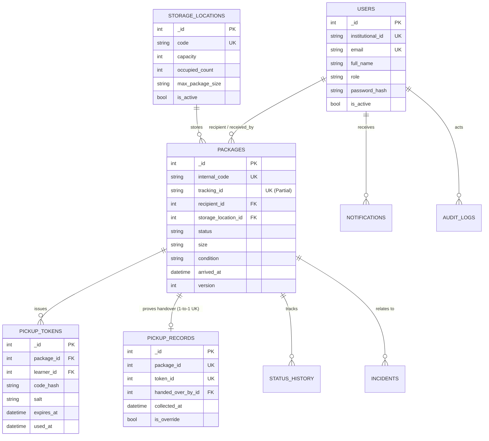

# System Architecture: Campus Delivery Management System (CDMS)

> **High-Reliability, Traceable, and Concurrency-Safe Campus Parcel Custody Management**  
> *Low-Level Design (LLD) & Architectural Specification*

---

## 1. Architectural Style & Overview

The **Campus Delivery Management System (CDMS)** is architected as a **Modular Monolith** following **Clean Architecture (Hexagonal / Onion)** principles. It digitizes physical parcel logging and custody transfer at university arrival checkpoints (**Gate No. 2**), replacing paper logbooks and unorganized shelves with an auditable, concurrency-defended workflow.

```
+---------------------------------------------------------------------------------------+
|                                    PRESENTATION LAYER                                 |
|   React 18 + TypeScript + Vite (SPA)           FastAPI Routes & Presenters (HTTP DTO) |
+------------------------------------------+--------------------------------------------+
                                           |
                                           v
+---------------------------------------------------------------------------------------+
|                                APPLICATION SERVICES LAYER                             |
|   PackageIntakeService      StorageAllocationService      PickupService               |
|   PackageLifecycleService   IncidentService               NotificationService         |
+------------------------------------------+--------------------------------------------+
                                           |
                    +----------------------+----------------------+
                    |                                             |
                    v                                             v
+---------------------------------------+   +-------------------------------------------+
|             DOMAIN LAYER              |   |            PERSISTENCE LAYER              |
|  - Table-Driven FSM (State Machine)   |   |  - UnitOfWork (Session Boundary)          |
|  - Strategy Pattern (Storage Sizing)  |   |  - Repository Pattern (PyMongo Repos)     |
|  - Observer Pattern (EventBus)        |   |  - Atomic Compare-And-Set (CAS) Engine    |
|  - Permissions & RBAC Matrix          |   |  - Atomic Integer Sequence Generator      |
|  - Domain Enums & Value Objects       |   +---------------------+---------------------+
|  (Zero external framework imports)    |                         |
+---------------------------------------+                         v
                                            +-------------------------------------------+
                                            |           DATABASE / INFRASTRUCTURE       |
                                            |  - MongoDB 7.0+ (Collections & Indexes)   |
                                            |  - In-Memory Mongomock Auto-Fallback      |
                                            |  - SMTP / In-App Notification Channels    |
                                            +-------------------------------------------+
```

### Architectural Key Characteristics:
1. **Separation of Concerns:** Business rules in the **Domain Layer** have zero dependencies on FastAPI, PyMongo, Pydantic, or HTTP libraries.
2. **Dependency Inversion (DIP):** Services depend solely on abstract `typing.Protocol` interfaces (`StorageAllocationStrategy`, `PackageRepository`, `NotificationChannel`).
3. **Atomic Concurrency Defense:** Standalone MongoDB deployments lack distributed locking; CDMS achieves ironclad race-condition safety via single-document atomic Compare-And-Set (`find_one_and_update`) and unique database constraints.
4. **Single Source of Truth:** A central composition root (`container.py`) instantiates and wires all singleton dependencies and configuration.

---

## 2. End-to-End Component Architecture

The diagram below illustrates how client interactions traverse through the system boundaries from the React frontend to MongoDB storage:



---

## 3. Layered Architecture & Inversion of Control

The application enforces a strict **4-layer architectural hierarchy** where inner layers are completely agnostic of outer layers:

```
[ HTTP Controller / API Routes ]
             │ (depends on)
             ▼
[ Application Services & Presenters ]
             │ (depends on)
             ▼
[ Domain Layer (FSM, Strategies, Enums, Rules) ] ◄── (Zero framework dependencies)
             ▲
             │ (implements protocols)
[ Repositories & Infrastructure (PyMongo / Models) ]
```

### 1. Presentation & Controller Layer (`backend/app/api/`)
* **Role:** Translates HTTP requests into strongly-typed Pydantic DTOs, executes route authorization dependencies (`require(Permission.X)`), delegates work to Application Services, and applies role-based field redactions via **Presenters** (`api/presenters.py`).
* **Invariants:** Controllers contain **no business decisions**. They never decide whether a package is allowed to move to `COLLECTED`; they ask `PickupService`, which in turn asks `PackageStateMachine`.

### 2. Application Services Layer (`backend/app/services/`)
* **Role:** Orchestrates end-to-end use cases, manages Unit of Work persistence transactions (`uow.commit()`), coordinates domain entities, and invokes the event bus.
* **Separation:**
  * `PackageIntakeService`: Parcel registration, tracking ID duplicate checks, and internal code generation.
  * `StorageAllocationService`: Shelf capacity reservations and re-allocations.
  * `PickupService`: One-time password (OTP) generation, token verification, and handover finalization.
  * `PackageTransitioner`: Central gateway for all status changes.

### 3. Pure Domain Layer (`backend/app/domain/`)
* **Role:** Houses the enterprise rules, state machine, algorithms, and interfaces.
* **Characteristics:** Pure Python 3.12 without PyMongo, FastAPI, or Pydantic imports.
  * `state_machine.py`: Explicit, table-driven Finite State Machine (FSM) defining all 22 valid state transitions, allowed actor roles, and precondition guards.
  * `allocation.py`: Strategy pattern implementations (`SuitableSizeStrategy`, `FirstAvailableStrategy`).
  * `events.py`: In-memory `EventBus` and `DomainEvent` classes (Observer pattern).
  * `enums.py`: Closed system vocabularies (`Role`, `PackageStatus`, `PackageSize`, `PackageCondition`).

### 4. Persistence & Infrastructure Layer (`backend/app/repositories/` & `infrastructure/`)
* **Role:** Implements repository protocols, serializes/deserializes BSON documents to plain dataclasses (`Document` base class), manages atomic MongoDB operations, and handles notification delivery (SMTP / In-App).

---

## 4. Concurrency Architecture & Anti-Double-Collection Defense

One of the central design challenges of a university parcel custody hub is **preventing race conditions** (e.g. two guards scanning the same package at the same second, or simultaneous allocation of the final shelf slot).

Because standalone MongoDB does not support multi-document distributed locking, CDMS implements a **4-layer defense-in-depth architecture**:



### Concurrency Mechanisms in Code:
1. **Token Invalidation CAS:** `MongoPickupTokenRepository.mark_used()` updates `used_at` conditionally where `used_at is None`. Only one concurrent request can ever transition a token.
2. **Package Lifecycle CAS:** `MongoPackageRepository.compare_and_set_status()` matches `{"_id": id, "status": expected}` and increments `version`. If another thread altered the package, CAS returns `False` and aborts.
3. **Database-Level Unique Key:** Unique index on `pickup_records.package_id`. Even if application-level checks were bypassed, MongoDB rejects a second insert with `DuplicateKeyError`.
4. **Storage Slot Reservation CAS:** `MongoStorageRepository.try_reserve()` matches `{"_id": loc_id, "$expr": {"$lt": ["$occupied_count", "$capacity"]}}` and increments `$occupied_count`. Racks can never be over-allocated.

---

## 5. Applied Design Patterns Matrix

| Pattern | Category | File & Class | Why Chosen | Alternative Rejected |
|---|---|---|---|---|
| **Strategy** | Behavioural | `domain/allocation.py`<br>`StorageAllocationStrategy` | Supports dynamic rack assignment algorithms based on parcel dimensions and warehouse packing rules. | Hardcoded `if/else` checks scattered inside storage services. |
| **State** | Behavioural | `domain/state_machine.py`<br>`PackageStateMachine` | Table-driven FSM enforcing 22 permitted status transitions, role authorizations, and precondition guards. | Classic GoF 12-class State hierarchy (avoids 144 method overrides across REST endpoints). |
| **Factory** | Creational | `infrastructure/notifications.py`<br>`NotificationChannelFactory` | Dynamically instantiates notification channels (In-App, Console, SMTP) based on runtime `.env` settings. | Hardcoded conditional channel construction in business services. |
| **Observer** | Behavioural | `domain/events.py`<br>`EventBus`, `DomainEvent` | Publishes domain events (`PackageStatusChanged`) only after UoW database commit, isolating notification failures. | Synchronous calls from services directly to email dispatchers. |
| **Builder** | Creational | `repositories/filters.py`<br>`PackageFilterBuilder` | Fluent, readable construction of complex multi-criteria package search queries. | Telescoping constructor arguments with 8+ positional parameters. |
| **Repository** | Architectural | `repositories/mongo_repos.py`<br>`MongoPackageRepository` | Hides PyMongo queries, projections, and BSON translations behind typed domain protocols. | Scattering raw PyMongo driver calls directly across FastAPI route functions. |
| **Unit of Work** | Architectural | `repositories/unit_of_work.py`<br>`UnitOfWork` | Maintains dirty state across repositories during a single use case, deferring events until `commit()`. | Independent repository commits that leave database in half-applied states on error. |
| **Decorator** | Structural | `api/dependencies.py`<br>`require(Permission.X)` | Parameterized dependency decorator verifying fine-grained RBAC permissions before route execution. | Duplicating role checks and 403 exception handling inside every route body. |
| **Singleton** | Creational | `container.py` (`container`)<br>`database.py` (`_client`, `_db`) | Module-level singleton maintaining shared MongoClient connection pools and dependency injection graph. | Classic GoF `__new__` singleton boilerplate that interferes with unit testing. |

---

## 6. Package Lifecycle Finite State Machine (FSM)

The lifecycle of every package from campus intake to final custody transfer is strictly governed by `PackageStateMachine`:



### Status Types:
* **Terminal States:** `COLLECTED`, `RETURNED`, `LOST` (irreversible; automatically releases shelf capacity).
* **Awaiting Collection States:** `STORED`, `READY_FOR_PICKUP`, `PICKUP_REQUESTED` (eligible for daily overdue sweeps after 3 days).

---

## 7. Database Architecture & Indexing Strategy

CDMS uses **MongoDB 7.0+** with documents modeled via dataclasses. Integers are used for primary IDs (generated via an atomic counter) to provide clean REST URLs.



### Essential Database Indexes (`infrastructure/database.py`):
1. `users.institutional_id` (Unique, Ascending) - Fast login & intake lookup.
2. `users.email` (Unique, Ascending) - Student email uniqueness.
3. `packages.internal_code` (Unique, Ascending) - Campus parcel barcode identifier.
4. `packages.tracking_id` (Unique, Partial Filter Expression: `{"tracking_id": {"$type": "string"}}`) - Allows multiple packages without tracking IDs, but prevents duplicate courier numbers.
5. `pickup_records.package_id` (Unique, Ascending) - Database-level double collection prevention.
6. `pickup_records.token_id` (Unique, Ascending) - Single-use token enforcement.
7. `idempotency_keys(user_id, scope, key)` (Unique Compound) - Idempotent replay safety.
8. `packages(status, arrived_at)` (Compound) - Powers high-speed overdue query sweeps.

---

## 8. Directory & Codebase Mapping

```
campus-delivery/
├── ARCHITECTURE.md                  # <-- THIS FILE: System Architecture Document
├── README.md                        # Master Project Documentation & Run Guide
├── docker-compose.yml               # Local full-stack container orchestration
├── backend/
│   ├── app/
│   │   ├── api/                     # Controller Layer (HTTP, DTOs, Presenters)
│   │   │   ├── dependencies.py      # Dependency injection & RBAC decorator
│   │   │   ├── presenters.py        # DTO projections & field redactions
│   │   │   └── routes/              # Sub-routers (/auth, /packages, /pickups)
│   │   ├── container.py             # Composition Root (Inversion of Control)
│   │   ├── core/                    # System Settings, Security, RFC 7807 Errors
│   │   ├── domain/                  # PURE Domain Layer (Zero Framework Imports)
│   │   │   ├── allocation.py        # Strategy Pattern (Rack Sizing)
│   │   │   ├── enums.py             # Roles, Statuses, Sizes, Conditions
│   │   │   ├── events.py            # Observer Pattern (EventBus & DomainEvent)
│   │   │   ├── interfaces.py        # Abstract Protocols (Strategy, Channels)
│   │   │   ├── permissions.py       # RBAC Permission Matrix
│   │   │   └── state_machine.py     # Table-Driven FSM (22 Transitions)
│   │   ├── infrastructure/          # Low-Level Tech (PyMongo, Document, SMTP)
│   │   │   ├── database.py          # MongoClient, Indexes, next_id Counter
│   │   │   ├── models.py            # Plain Dataclass Document Models
│   │   │   └── notifications.py     # NotificationChannelFactory (Factory Pattern)
│   │   ├── repositories/            # Data Access & Concurrency
│   │   │   ├── filters.py           # Builder Pattern (PackageFilterBuilder)
│   │   │   ├── interfaces.py        # Repository Protocols (DIP)
│   │   │   ├── mongo_repos.py       # PyMongo Implementations & Atomic CAS
│   │   │   └── unit_of_work.py      # Unit of Work Pattern Context Manager
│   │   ├── services/                # Application Services (Use Cases)
│   │   │   ├── package_intake.py    # FR-1 Parcel Intake Workflow
│   │   │   ├── pickup.py            # FR-4/FR-5 Handover & Anti-Double Collection
│   │   │   ├── storage_allocation.py# FR-2 Shelf Assignment Workflow
│   │   │   └── transitions.py       # Centralized State Mutator
│   │   ├── main.py                  # FastAPI Application Factory & Lifespan
│   │   └── seed.py                  # Seed Data Fixtures (Demo Accounts)
│   └── tests/                       # 92 Automated Tests (Unit, Service, API)
├── frontend/                        # React 18 + TypeScript + Vite UI
│   ├── src/
│   │   ├── api/                     # HTTP Client & Endpoints
│   │   ├── auth/                    # AuthContext & Route Guards
│   │   ├── components/              # Shared UI Widgets (Bilingual en/hi)
│   │   └── pages/                   # Role-Gated Pages (Learner, Security, Admin)
└── docs/                            # Capstone LLD Reports & Viva Guides
    ├── 01-requirements.md           # Requirements Analysis
    ├── 02-architecture.md           # Architecture Notes
    ├── 04-database.md               # MongoDB Database Schema Specification
    ├── 05-state-machine.md          # State Machine Diagrams & Roles
    ├── 07-solid-and-patterns.md     # SOLID Evidence & Design Patterns
    ├── 08-edge-cases.md             # Concurrency & Reliability Analysis
    ├── 15-capstone-presentation-deck.md # Viva Slide Script & Presentation Deck
    └── 16-viva-search-tags-index.md # Search Keywords & Viva Defense Answers
```

---

## 9. Verification & Architectural Proofs

To inspect or prove any architectural property during evaluation:

```bash
# 1. Run the full test suite (92 tests verifying FSM, CAS, and workflows)
PYTHONPATH=backend backend/.venv/bin/pytest backend/tests -v

# 2. Search for any architectural concept directly in the codebase comments
#    (e.g., [EVAL-4: SOLID-SRP], [EVAL-5: PATTERN-STRATEGY], [EVAL-9: ERROR-HANDLING-CONCURRENCY])
grep -rn "EVAL-5: PATTERN" backend/app/
```
