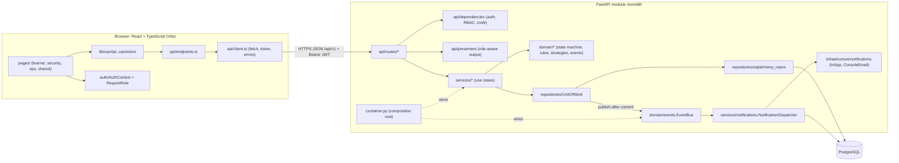

# 2. Architecture

## 2.1 Component diagram



## 2.2 Layers and their rules

| Layer | Folder | Responsibility | May depend on |
|---|---|---|---|
| Presentation | `frontend/src` | Screens, forms, role-aware navigation. No business rules beyond convenience hiding. | Backend HTTP API only |
| API | `app/api` | HTTP: parse/validate input, authenticate, check permission, call a service, shape the response, map errors to status codes. | services, schemas, domain (read-only helpers) |
| Schemas | `app/schemas` | Pydantic request/response models and field validation. | domain enums |
| Services | `app/services` | Application use cases; own the transaction boundary (`uow.commit()`); coordinate repositories and domain rules. | domain, repositories |
| Domain | `app/domain` | Pure business rules: lifecycle state machine, permissions, pickup-token rules, overdue rule, allocation strategies, events, protocols. **No SQLAlchemy or FastAPI imports.** | `app/core` only |
| Repositories | `app/repositories` | Persistence: queries and atomic conditional updates; Unit of Work. | infrastructure models |
| Infrastructure | `app/infrastructure` | Engine/session, ORM models, notification channels. | core |

**Rule of thumb for the viva:** a route handler never decides *whether* something is allowed by
business rules; it asks a service. The service asks the domain (`state_machine.check`, `ensure_token_usable`).

## 2.3 How one request flows (complete handover)

1. `POST /api/v1/pickups/complete` with JSON body and `Idempotency-Key` header.
2. `require(Permission.PICKUP_HANDOVER)` decodes the JWT, loads the user from the DB (inactive → 401) and checks the role permission (→ 403).
3. Pydantic validates the body (`code` must be 6 digits, → 422).
4. `PickupService.complete` locks the package row, checks the idempotency key, validates the code via `domain.pickup_rules`, consumes the token with a conditional UPDATE, applies `PICKUP_REQUESTED → COLLECTED` through `PackageTransitioner` (which releases the shelf, writes history and audit, and queues an event), adds the `pickup_records` row and the idempotency record, then commits.
5. After commit the Unit of Work publishes `PackageStatusChanged`; the notification dispatcher writes and sends the "Package collected" message in its own transaction.
6. The presenter returns a `PickupRecordOut`. Errors anywhere are rolled back and returned as `{"error": {code, message, details, request_id}}`.

## 2.4 Why a modular monolith and not microservices

- **Scale does not require it.** One gate, a few thousand packages a month. A single process on one server handles this with large headroom.
- **The core operations need ACID transactions across several tables.** Handover touches packages, tokens, storage, pickup records, history, audit and idempotency keys. In one database this is one transaction. Across services it would need sagas, compensations and eventual consistency, which add failure modes we would then have to test and explain.
- **Team and timeline.** One student, one deployment, one codebase to debug.
- **We still keep the benefits of modularity**: clear layers, services per use case, protocols at the seams, and a composition root. Those seams are exactly where a module could be extracted later (section 2.10).

## 2.5 Why PostgreSQL

- Real row-level locks (`SELECT … FOR UPDATE`) and correct transaction isolation, which the handover depends on.
- Constraints enforced by the database: foreign keys, `UNIQUE`, `CHECK (occupied_count <= capacity)`.
- Mature, free, widely hosted; excellent support in SQLAlchemy and Alembic.
- Timezone-aware `timestamptz`, JSON columns for audit details, partial and composite indexes when we need them.
- A document store would make multi-table atomic updates and referential integrity harder; SQLite lacks concurrent writers and row locks (we only use it for development and tests, and compensate with `BEGIN IMMEDIATE`).

## 2.6 How double pickup is prevented

Four independent layers in `services/pickup.py` and the schema; any one alone would stop the second collection.

| Layer | Mechanism | Where |
|---|---|---|
| 1. Serialise | `SELECT … FROM packages WHERE internal_code = ? FOR UPDATE`. A second handover for the same package waits until the first commits, then sees status `COLLECTED` and gets `409 ALREADY_COLLECTED`. | `SqlPackageRepository.get_by_code_for_update` |
| 2. Consume the code once | `UPDATE pickup_tokens SET used_at = now WHERE id = ? AND used_at IS NULL AND revoked_at IS NULL`, and the service requires exactly 1 affected row. | `SqlPickupTokenRepository.mark_used` |
| 3. Change status only from the expected state | `UPDATE packages SET status = 'COLLECTED' … WHERE id = ? AND status = 'PICKUP_REQUESTED'`, requiring 1 row. | `SqlPackageRepository.compare_and_set_status` via `PackageTransitioner` |
| 4. Database guarantee | `pickup_records.package_id` and `pickup_records.token_id` are `UNIQUE`. A second insert fails and the transaction rolls back. | migration `0001`, model `PickupRecord` |

Verified by `test_concurrent_handover_results_in_exactly_one_collection` (two threads, two staff, same code, on both PostgreSQL and SQLite).

## 2.7 How storage capacity is protected against concurrent allocations

A slot is reserved with one atomic statement:

```sql
UPDATE storage_locations
SET occupied_count = occupied_count + 1
WHERE id = :id AND is_active AND occupied_count < capacity
```

If two requests race for the last slot, the database evaluates the `WHERE` condition for each
update in turn; the second finds `occupied_count = capacity` and updates 0 rows, so the service raises
`409 STORAGE_FULL` (or, for automatic allocation, tries the next candidate the strategy ranked). A
`CHECK (occupied_count <= capacity)` constraint makes over-allocation impossible even if code were wrong.
Releasing a slot (collection, return, lost, or moving shelves) is the mirror `- 1 WHERE occupied_count > 0`.

Invariant: `occupied_count` equals the number of packages whose `storage_location_id` points at the
location. It is a deliberate denormalisation so that the check-and-reserve is one statement.
Verified by `test_concurrent_allocation_never_exceeds_capacity` (three threads, capacity 1).

## 2.8 How duplicate requests are handled

| Operation | Retry behaviour | How it is enforced |
|---|---|---|
| Register package (`POST /packages`) | **Idempotent with `Idempotency-Key`.** Same key + same body → `200` with the original package and header `Idempotent-Replayed: true`. Same key + different body → `409 IDEMPOTENCY_KEY_REUSED`. Without a key, a repeated tracking ID is still caught as a duplicate. | Table `idempotency_keys` with `UNIQUE(user_id, scope, key)`, written in the same transaction as the package. A concurrent duplicate hits the unique constraint, rolls back, and is answered with the stored result. |
| Complete handover (`POST /pickups/complete`) | **Idempotent with `Idempotency-Key`**: a retry returns the original pickup record (`200`). Without a key, a retry gets `409 ALREADY_COLLECTED`, which is safe (nothing happens twice). | Same table; key checked after the row lock, so a waiting retry sees the committed first attempt. |
| Request pickup code | **Safe retry**: every call issues a new code and revokes the previous one, so the latest response shown to the learner is always the valid code. We cannot replay the old response because the plaintext code is never stored. | `revoke_active` + new token in one transaction |
| Assign storage to the same location again | No-op (no second reservation). | `StorageAllocationService.assign` compares with current location |
| Resolve an incident twice, mark a notification read twice | No-op. | Status/`read_at` checks |

The frontend creates one key per form submission (`newIdempotencyKey()`) and reuses it if the user presses the button again after a network error.

## 2.9 What happens when notification delivery fails

1. The package change commits first. Only then does the Unit of Work publish the event.
2. The dispatcher (its own DB session) writes one `notifications` row per channel with status `PENDING` and commits, so the record exists even if every channel fails.
3. It calls each channel. Success → `SENT` (meaning *handed to the channel*, never "delivered" or "read"); failure → `FAILED` with `last_error`. Exceptions never propagate back to the request; the event bus also isolates each subscriber.
4. The dashboard shows the failed count; admins call `POST /notifications/retry-failed`, which retries `FAILED`/stuck `PENDING` rows up to `NOTIFICATION_MAX_ATTEMPTS` (3).
5. The in-app message is still in the learner's inbox, which is why the learner can always see it in the app.

Verified by `test_notification_failure_does_not_undo_the_package_update`.

Limitation: if the API process crashes between commit and dispatch, no notification row is written for that event. A transactional outbox (write the event row in the same transaction, process it later) closes that gap; see `10-limitations.md`.

## 2.10 How the system could scale

| Pressure | Step (in order of cost) |
|---|---|
| More API traffic | Run several Uvicorn/Gunicorn workers or containers behind a load balancer; the API is stateless except the in-memory login limiter (move it to the database or a shared cache at that point). |
| Larger tables | Existing indexes cover the hot queries; add pagination by keyset, archive closed packages older than N months into a history table, and add PostgreSQL read replicas for reports. |
| Slow notifications (real email/SMS) | Transactional outbox table + a background worker process that sends and retries, so requests never wait on a provider. |
| Several gates/campuses | Add a `gate` (or `site`) entity referenced by storage locations and packages; scope staff permissions by gate. |
| Heavy reporting | Materialised views or a nightly summary table; or a separate reporting replica. |

## 2.11 What would be extracted into a separate service, and only when

| Candidate | Extract only if … |
|---|---|
| Notification delivery worker | Real providers are added and sending becomes slow or needs its own retry/scaling policy. It already sits behind an event bus and channel protocol, so it can move to a worker consuming an outbox table. |
| Reporting/analytics | Report queries start to slow the transactional database; move to a read replica or warehouse fed by change events. |
| Identity/authentication | The campus adopts single sign-on (SAML/OIDC); replace local login with the identity provider rather than building our own service. |

The **package lifecycle, storage and pickup** must stay together: they share one transaction for the
handover and splitting them would reintroduce the double-collection problem across a network boundary.
