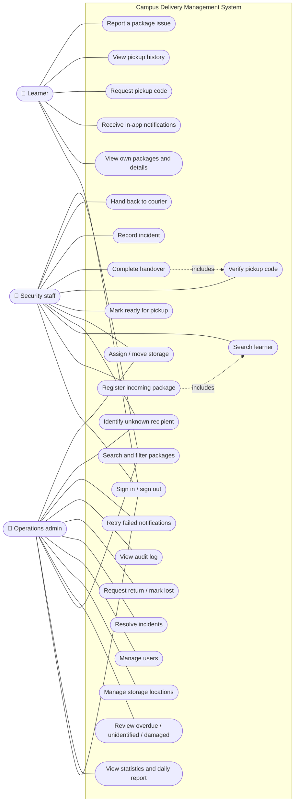
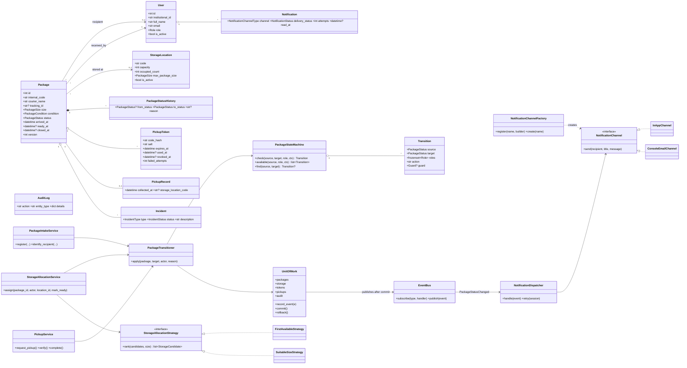
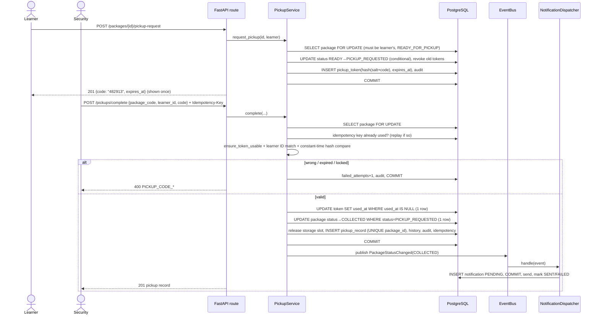

# 3. UML diagrams

## 3.1 Use-case diagram

Mermaid has no native use-case diagram, so actors are shown on the left and use cases (rounded) are grouped by role.

## 3.2 Class diagram (main domain and service classes)

**Why no `Learner`/`SecurityStaff`/`Admin` subclasses?** The three roles have identical data and
differ only in permissions. A single `User` with a `role` value plus a permission table
(`domain/permissions.py`) is simpler, avoids type changes when a person's role changes, and avoids
subclasses that would override nothing (which would be inheritance only to "show OOP").
Inheritance is used where real substitutable behaviour exists: strategies and channels (via protocols),
exception hierarchy (`AppError → ConflictError → StorageFullError`), and `TimestampMixin`.

## 3.3 Sequence diagram: request code and complete handover

