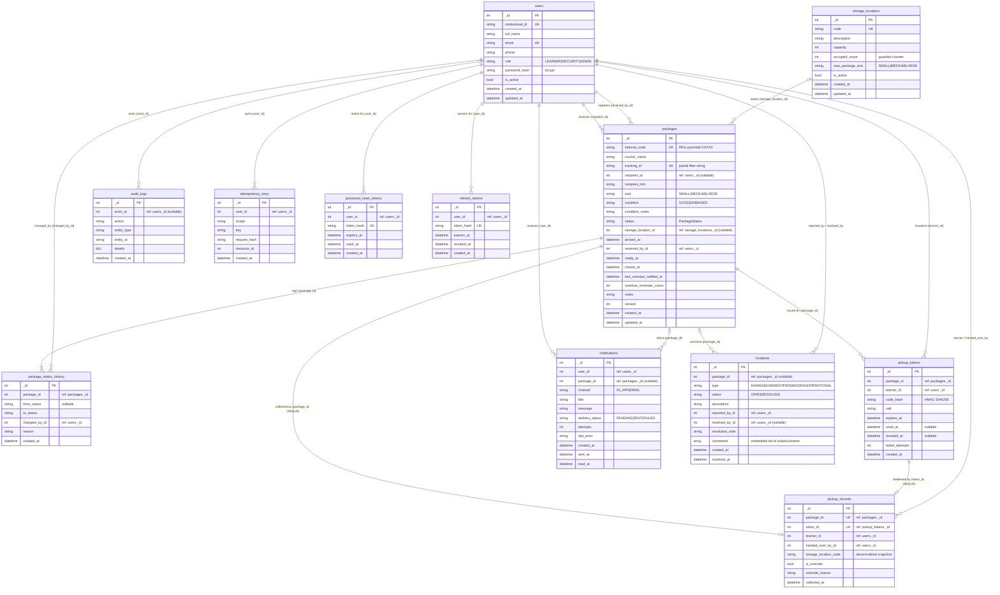

# 4. MongoDB Database Design

CampusDelivery uses **MongoDB 6+/7+** via the synchronous **PyMongo** driver as its document store. Standalone MongoDB deployments lack distributed multi-document ACID transactions; therefore, relational foreign key constraints are not enforced by the database. Instead, **document references are integer IDs managed and validated by the application layer**, while atomicity and concurrency control are guaranteed through atomic single-document operations (Compare-And-Set via `find_one_and_update`) and targeted unique indexes.

---

## 4.1 Logical ER Diagram



> **Note on Foreign Keys & References:**
> In MongoDB, all entity IDs (`_id`) and relational pointers (e.g. `recipient_id`, `storage_location_id`) are stored as **integers**. The database does not enforce referential integrity cascades or foreign key constraints. Referential consistency is strictly enforced by the **application service layer** (`UnitOfWork` and Domain Rules).

---

## 4.2 Document Collections Specification

Each collection stores BSON documents mapped to Python dataclass models inheriting from `app.infrastructure.models.Document`.

### 1. `users`
Represents all system actors (Learners, Security guards, Operations Administrators).
- **`_id`** (`int`): Unique sequential user identifier.
- **`institutional_id`** (`string`): Unique university roll number or staff ID (e.g., `LRN-1001`, `SEC-001`, `ADM-001`).
- **`full_name`** (`string`): Full name.
- **`email`** (`string`): Unique university email address (`@example.edu`).
- **`phone`** (`string | null`): Optional contact number.
- **`role`** (`string`): User role (`LEARNER`, `SECURITY`, `ADMIN`).
- **`password_hash`** (`string`): Salted bcrypt password hash.
- **`is_active`** (`bool`): Account active flag (soft deactivation; inactive users are blocked on token check).
- **`created_at`, `updated_at`** (`datetime`): UTC timestamps.
- **Embedded vs Referenced**: Independent master document. Referenced by `packages`, `pickup_records`, `audit_logs`, etc.

### 2. `storage_locations`
Represents shelves, bays, or physical lockers located at Gate No. 2.
- **`_id`** (`int`): Unique sequential location identifier.
- **`code`** (`string`): Unique shelf code (e.g., `G2-A1`, `G2-B1`).
- **`description`** (`string | null`): Physical notes (e.g., "Top shelf, small envelopes").
- **`capacity`** (`int`): Total parcel slot capacity.
- **`occupied_count`** (`int`): Denormalized count of packages currently occupying this location. Protected field updated exclusively via atomic CAS increments (`$inc: 1`).
- **`max_package_size`** (`string`): Maximum parcel size accommodated (`SMALL`, `MEDIUM`, `LARGE`).
- **`is_active`** (`bool`): Operational status. Inactive shelves reject new reservations.
- **`created_at`, `updated_at`** (`datetime`): UTC timestamps.
- **Embedded vs Referenced**: Master entity referenced by `packages.storage_location_id`.

### 3. `packages`
Core entity representing a physical delivery parcel arriving at campus.
- **`_id`** (`int`): Sequential package identifier.
- **`internal_code`** (`string`): Human-readable intake code (`PKG-YYMMDD-XXXXX`).
- **`courier_name`** (`string`): Delivering courier (e.g., `BlueDart`, `Amazon Logistics`).
- **`tracking_id`** (`string | null`): Normalized courier tracking barcode number. Nullable for unregistered local drops; unique when present.
- **`recipient_id`** (`int | null`): Logical reference to `users._id`. Nullable while status is `UNIDENTIFIED`.
- **`recipient_hint`** (`string | null`): Unparsed label text from intake when recipient is ambiguous.
- **`size`** (`string`): Package size category (`SMALL`, `MEDIUM`, `LARGE`).
- **`condition`** (`string`): Physical intake condition (`GOOD`, `DAMAGED`).
- **`condition_notes`** (`string | null`): Required damage description if `condition == DAMAGED`.
- **`status`** (`string`): FSM status (`RECEIVED`, `VERIFIED`, `STORED`, `READY_FOR_PICKUP`, `PICKUP_REQUESTED`, `COLLECTED`, `UNIDENTIFIED`, `DAMAGED`, `UNDER_INVESTIGATION`, `LOST`, `RETURN_REQUESTED`, `RETURNED`).
- **`storage_location_id`** (`int | null`): Logical reference to `storage_locations._id`. Cleared when parcel is collected or returned.
- **`arrived_at`** (`datetime`): Intake timestamp.
- **`received_by_id`** (`int`): Logical reference to `users._id` (security officer who logged intake).
- **`ready_at`** (`datetime | null`): Timestamp when parcel transitioned to `READY_FOR_PICKUP`.
- **`closed_at`** (`datetime | null`): Terminal timestamp (`COLLECTED`, `LOST`, or `RETURNED`).
- **`last_overdue_notified_at`** (`datetime | null`): Timestamp of latest overdue reminder.
- **`overdue_reminder_count`** (`int`): Number of reminders sent.
- **`notes`** (`string | null`): Operational notes.
- **`version`** (`int`): Document version counter.
- **`created_at`, `updated_at`** (`datetime`): UTC timestamps.
- **Hydrated Relations**: In code, repositories hydrate `recipient`, `received_by`, and `storage_location` models on retrieval.

### 4. `package_status_history`
Append-only audit trail of every status transition.
- **`_id`** (`int`): Sequential history entry identifier.
- **`package_id`** (`int`): Reference to `packages._id`.
- **`from_status`** (`string | null`): Source lifecycle status.
- **`to_status`** (`string`): Target lifecycle status.
- **`changed_by_id`** (`int`): Reference to `users._id` (actor who authorized the transition).
- **`reason`** (`string | null`): Human-readable operational explanation.
- **`created_at`** (`datetime`): Timestamp of transition.

### 5. `pickup_tokens`
Time-bounded, hashed verification codes for learner pickup.
- **`_id`** (`int`): Sequential token identifier.
- **`package_id`** (`int`): Reference to `packages._id`.
- **`learner_id`** (`int`): Reference to `users._id` (learner requesting pickup).
- **`code_hash`** (`string`): HMAC-SHA256 hash of the 6-digit plaintext code combined with the salt. The plaintext code is never stored.
- **`salt`** (`string`): Cryptographic random salt.
- **`expires_at`** (`datetime`): Expiration time (typically `created_at` + 30 minutes).
- **`used_at`** (`datetime | null`): Timestamp when redeemed.
- **`revoked_at`** (`datetime | null`): Timestamp when invalidated (e.g. learner generated a new code).
- **`failed_attempts`** (`int`): Counter tracking consecutive wrong code guesses (locks token at 5).
- **`created_at`** (`datetime`): Generation timestamp.

### 6. `pickup_records`
Permanent legal receipt and proof of package handover.
- **`_id`** (`int`): Sequential record identifier.
- **`package_id`** (`int`): Reference to `packages._id`. Unique index enforces exactly one handover per package.
- **`token_id`** (`int`): Reference to `pickup_tokens._id`. Unique index enforces single redemption.
- **`learner_id`** (`int`): Reference to `users._id` who collected the parcel.
- **`handed_over_by_id`** (`int`): Reference to `users._id` (staff officer at Gate No. 2).
- **`storage_location_code`** (`string | null`): Denormalized shelf code snapshot for historical reporting.
- **`is_override`** (`bool`): True if completed via supervisor manual bypass.
- **`override_reason`** (`string | null`): Required rationale for manual bypass.
- **`collected_at`** (`datetime`): Timestamp of handover.

### 7. `notifications`
Notification log and in-app message inbox.
- **`_id`** (`int`): Sequential notification identifier.
- **`user_id`** (`int`): Recipient reference (`users._id`).
- **`package_id`** (`int | null`): Optional reference to `packages._id`.
- **`channel`** (`string`): Dispatch channel (`IN_APP`, `EMAIL`).
- **`title`** (`string`): Subject header.
- **`message`** (`string`): Full notification body.
- **`delivery_status`** (`string`): Status (`PENDING`, `SENT`, `FAILED`).
- **`attempts`** (`int`): Delivery attempt count (up to 3).
- **`last_error`** (`string | null`): Error trace if channel dispatch failed.
- **`created_at`, `sent_at`, `read_at`** (`datetime | null`): Lifecycle timestamps.

### 8. `incidents`
Operational issues, damage reports, unidentified packages, or student claims.
- **`_id`** (`int`): Sequential incident identifier.
- **`package_id`** (`int | null`): Optional associated parcel reference (`packages._id`).
- **`type`** (`string`): Incident category (`DAMAGE`, `UNIDENTIFIED`, `MISSING`, `OPERATIONAL`).
- **`status`** (`string`): Resolution state (`OPEN`, `RESOLVED`).
- **`description`** (`string`): Issue description.
- **`reported_by_id`** (`int`): Reporter reference (`users._id`).
- **`resolved_by_id`** (`int | null`): Staff resolver reference (`users._id`).
- **`resolution_note`** (`string | null`): Explanation of resolution actions taken.
- **`comments`** (`array`): **Embedded documents** containing nested discussion updates:
  ```json
  [
    {
      "comment_id": 1,
      "author_id": 3,
      "message": "Courier notified about damaged carton.",
      "created_at": "2026-11-13T10:00:00Z"
    }
  ]
  ```
- **`created_at`, `resolved_at`** (`datetime | null`): Lifecycle timestamps.

### 9. `audit_logs`
Immutable security and compliance trail.
- **`_id`** (`int`): Sequential audit log identifier.
- **`actor_id`** (`int | null`): Reference to `users._id` (null for unauthenticated failed logins).
- **`action`** (`string`): Event identifier (e.g., `auth.login`, `package.intake`, `pickup.completed`).
- **`entity_type`** (`string`): Target model (`package`, `user`, `storage_location`).
- **`entity_id`** (`string | null`): Target identifier.
- **`details`** (`dict`): Arbitrary structured BSON context (e.g. old vs new shelf code).
- **`created_at`** (`datetime`): Event timestamp.

### 10. `idempotency_keys`
Deduplication registry for network retries of non-idempotent operations (`POST /packages`, `POST /pickups/complete`).
- **`_id`** (`int`): Sequential record identifier.
- **`user_id`** (`int`): Reference to `users._id`.
- **`scope`** (`string`): Domain operation scope (e.g., `packages.create`, `pickups.complete`).
- **`key`** (`string`): Client-provided `Idempotency-Key` header value.
- **`request_hash`** (`string`): SHA-256 fingerprint of the request payload.
- **`resource_id`** (`int`): ID of the successfully created resource, returned on retry.
- **`created_at`** (`datetime`): Creation timestamp.

### 11. `password_reset_tokens` & `refresh_tokens`
Authentication session and credential recovery storage.
- **`_id`** (`int`): Sequential token identifier.
- **`user_id`** (`int`): Reference to `users._id`.
- **`token_hash`** (`string`): Unique SHA-256 hash of the recovery or refresh secret.
- **`expires_at`** (`datetime`): Expiration threshold.
- **`used_at` / `revoked_at`** (`datetime | null`): Invalidation timestamps.
- **`created_at`** (`datetime`): Issuance timestamp.

### 12. `counters`
Internal sequence generator for atomic integer primary keys (`_id`).
- **`_id`** (`string`): Name of the target collection (e.g., `"packages"`, `"users"`).
- **`seq`** (`int`): Current maximum allocated sequence number.

---

## 4.3 Index Registry

All database indexes are configured declaratively in [`backend/app/infrastructure/database.py`](file:///Users/kalashkumarithakur/Desktop/campus-delivery/backend/app/infrastructure/database.py#L88-L107) inside `init_db()`.

| Collection | Index Keys | Type | Query / Invariant Served |
|---|---|---|---|
| `users` | `{"institutional_id": 1}` | Unique | Enforces single account per university roll/staff ID; accelerates login lookup. |
| `users` | `{"email": 1}` | Unique | Enforces unique email constraint; fast authentication lookup. |
| `packages` | `{"internal_code": 1}` | Unique | Direct parcel lookup in security scanning and URL routes. |
| `packages` | `{"tracking_id": 1}` | Unique (Partial) | **Partial Index**: `partialFilterExpression={"tracking_id": {"$type": "string"}}`. Prevents duplicate courier intake while permitting multiple unbarcoded parcels (`null`). |
| `packages` | `{"status": 1, "arrived_at": 1}` | Compound | Powers security intake queues, operations dashboard tabs, and overdue package sweeps. |
| `pickup_records` | `{"package_id": 1}` | Unique | **Hardware-level invariant**: Guarantee that a parcel can never be collected more than once. |
| `pickup_records` | `{"token_id": 1}` | Unique | Prevents a single pickup token from being redeemed across multiple transactions. |
| `idempotency_keys` | `{"user_id": 1, "scope": 1, "key": 1}` | Compound Unique | Enforces idempotent retry semantics per user and use case. |
| `notifications` | `{"user_id": 1, "created_at": 1}` | Compound | Powers learner in-app inbox sorted chronologically descending. |
| `password_reset_tokens` | `{"token_hash": 1}` | Unique | Fast lookup and duplicate prevention for password recovery tokens. |
| `password_reset_tokens` | `{"user_id": 1, "created_at": 1}` | Compound | Scoped queries for user token history and cleanup. |
| `refresh_tokens` | `{"token_hash": 1}` | Unique | Fast verification and rotation of JWT session refresh tokens. |
| `refresh_tokens` | `{"user_id": 1, "created_at": 1}` | Compound | User session invalidation and listing active sessions. |

---

## 4.4 Auto-Increment Counter Mechanism (`next_id`)

Standard MongoDB practice uses 12-byte BSON `ObjectId`s. However, CampusDelivery implements sequential positive integers (`1, 2, 3...`) for all entity IDs via an atomic counter pattern:

```python
def next_id(collection: str) -> int:
    """Atomically allocate the next integer id for a collection."""
    doc = get_db()["counters"].find_one_and_update(
        {"_id": collection},
        {"$inc": {"seq": 1}},
        upsert=True,
        return_document=ReturnDocument.AFTER,
    )
    return int(doc["seq"])
```

### Architectural Trade-offs of `next_id`:
| Benefit | Trade-off / Limitation |
|---|---|
| **Human Ergonomics**: Short, clean URLs (`/packages/42`) and predictable IDs matching student paper receipts and verbal reference at Gate No. 2. | **Contention on High Scale**: Every document insertion performs a serialized `$inc` on the `counters` collection, creating a write bottleneck at high concurrent ingestion rates. |
| **Clean Presentation**: No ugly 24-character hexadecimal strings in student-facing views or CSV exports. | **Sequence Gaps**: If an operation allocates an ID via `next_id` but aborts before insertion, that sequence number is permanently skipped. |
| **Compatibility**: Preserves seamless integer semantics across frontend TypeScript models and existing test fixtures. | **Sharding Complexity**: Multi-shard deployments require range chunking rather than a single counter document. |

---

## 4.5 Class to Collection to Repository Mapping

| Domain / Infrastructure Model | MongoDB Collection | Repository Implementation | Repository Protocol |
|---|---|---|---|
| `User` | `users` | `MongoUserRepository` | `UserRepository` |
| `StorageLocation` | `storage_locations` | `MongoStorageRepository` | `StorageRepository` |
| `Package` | `packages` | `MongoPackageRepository` | `PackageRepository` |
| `PackageStatusHistory` | `package_status_history` | *Embedded via `MongoPackageRepository` & `PackageTransitioner`* | *N/A (Managed via Package)* |
| `PickupToken` | `pickup_tokens` | `MongoPickupTokenRepository` | `PickupTokenRepository` |
| `PickupRecord` | `pickup_records` | `MongoPickupRecordRepository` | `PickupRecordRepository` |
| `Notification` | `notifications` | `MongoNotificationRepository` | `NotificationRepository` |
| `Incident` | `incidents` | `MongoIncidentRepository` | `IncidentRepository` |
| `AuditLog` | `audit_logs` | `MongoAuditRepository` | `AuditRepository` |
| `IdempotencyKey` | `idempotency_keys` | `MongoIdempotencyRepository` | `IdempotencyRepository` |
| `PasswordResetToken` | `password_reset_tokens` | `MongoPasswordResetTokenRepository` | `PasswordResetTokenRepository` |
| `RefreshToken` | `refresh_tokens` | `MongoRefreshTokenRepository` | `RefreshTokenRepository` |

---

## 4.6 Concurrency and Consistency Guarantees

Because standalone MongoDB does not support multi-document ACID transactions across arbitrary collections, consistency is guaranteed through three cooperative mechanisms:

1. **Compare-And-Set (CAS) via `find_one_and_update`**:
   - **Slot Reservation**: Reserving shelf space uses `find_one_and_update({"_id": location_id, "is_active": True, "occupied_count": {"$lt": capacity}}, {"$inc": {"occupied_count": 1}})`. If capacity is exceeded, 0 documents match and the reservation safely fails.
   - **Token Redemption**: Consuming a pickup token uses `find_one_and_update({"_id": token_id, "used_at": None, "revoked_at": None}, {"$set": {"used_at": now}})`. Exactly one thread succeeds.
2. **Database Unique Indexes as Ultimate Invariant Boundary**:
   - Even if two concurrent requests bypass application locks, the unique index on `pickup_records.package_id` will reject the second insert with a duplicate key error (`E11000`), preventing double collection.
3. **Compensating Unit of Work (`UnitOfWork`)**:
   - Tracks dirty entities and publishes domain events to the `EventBus` *only after* all writes have succeeded. On exception, buffered domain events are discarded so no erroneous notification is ever sent.

---

## 4.7 Diagram Synchronization Status

- The Mermaid ER diagram in section 4.1 represents the authoritative schema.
- **Image Artifact Status**:
  - `diagrams/12_database_er_schema_diagram.svg`: Updated to reflect MongoDB collection naming and logical references.
  - `diagrams/12_database_er_schema_diagram.png`: **STALE** (Raster binary generated from legacy SQL DDL; requires headless image rasterization tools not available in sandboxed CLI environment). Refer to the SVG and section 4.1 Mermaid diagram.
