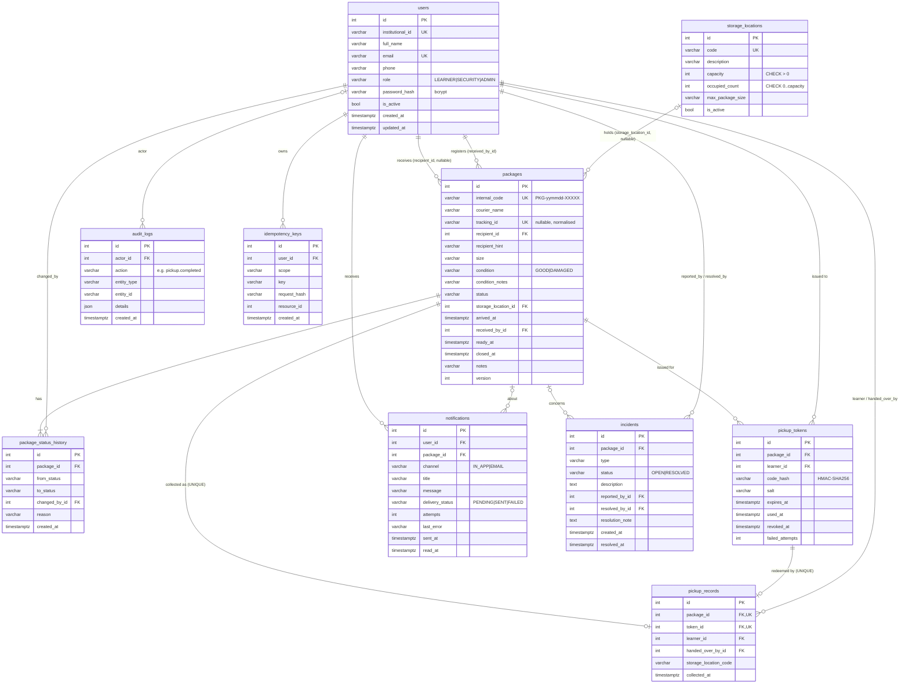

# 4. Database design

## 4.1 ER diagram

## 4.2 Tables and why each exists

| Table | Purpose | Key relationships |
|---|---|---|
| `users` | Everyone who signs in. Role is a column, not a separate table, because the three roles share all attributes. | Referenced by most tables |
| `storage_locations` | Shelves/bays at Gate No. 2 with capacity and the largest size they hold. | `packages.storage_location_id` (0..1 per package) |
| `packages` | One row per physical parcel. Holds current status, condition, recipient (nullable while unidentified) and current shelf. | Many-to-one to users (recipient, receiver) and storage |
| `package_status_history` | Append-only record of every status change with actor and reason. Answers "who changed what, when". | Many-to-one to packages and users |
| `pickup_tokens` | Pickup codes. Only a salted HMAC is stored; one package can have several tokens over time (expired/revoked), and only the latest unused one is valid. | Many-to-one to packages and users |
| `pickup_records` | Proof of handover: who collected, who handed over, when, from which shelf. `UNIQUE(package_id)` and `UNIQUE(token_id)`. | One-to-zero-or-one with packages and tokens |
| `notifications` | In-app inbox rows plus a delivery record per channel. | Many-to-one to users, optional package |
| `incidents` | Damage, unidentified recipient, learner reports, missing packages, operational notes. | Optional package, reporter, resolver |
| `audit_logs` | Security-relevant actions (logins, registrations, rejected duplicates, storage, pickups, failed verifications, user and storage changes). | Optional actor (failed login for unknown ID has none) |
| `idempotency_keys` | Remembers retried POSTs. `UNIQUE(user_id, scope, key)`. | Many-to-one to users |

Normalisation: each fact is stored once. Two deliberate exceptions, both documented in code:
`storage_locations.occupied_count` (enables the atomic capacity check, section 2.7) and
`pickup_records.storage_location_code` (a historical snapshot, because the package's
`storage_location_id` is cleared when the shelf is released).

## 4.3 Constraints and deletion policy

- All foreign keys are `ON DELETE RESTRICT`. Packages, users and records are never hard-deleted: deactivate users instead (`is_active = false`). This preserves history, pickup proof and audit integrity.
- Unique: `users.institutional_id`, `users.email`, `packages.internal_code`, `packages.tracking_id` (NULLs allowed, many), `storage_locations.code`, `pickup_records.package_id`, `pickup_records.token_id`, `idempotency_keys(user_id, scope, key)`.
- Check: `capacity > 0`, `occupied_count >= 0`, `occupied_count <= capacity`.
- Enumerations are stored as constrained-length `VARCHAR` (SQLAlchemy `Enum(native_enum=False)`) and validated by the application, which keeps migrations portable and adding a status a code-only change.
- Constraint names follow a naming convention (`uq_…`, `fk_…`, `ck_…`, `ix_…`) so Alembic can alter them later.

## 4.4 Indexes (frequent searches)

| Index | Serves |
|---|---|
| `uq_packages_tracking_id` | Duplicate detection, search by tracking ID |
| `ix_packages_recipient_id` | "My packages" for learners |
| `ix_packages_status`, `ix_packages_status_arrived_at` | Queues by status; overdue query (`status IN (…) AND arrived_at < cutoff`) |
| `ix_packages_arrived_at` | Date-range filters, daily report |
| `ix_packages_storage_location_id` | Packages on a shelf |
| `ix_users_institutional_id`, `ix_users_email` (unique) | Login and learner search |
| `ix_notifications_user_created` | A learner's inbox, newest first |
| `ix_audit_logs_created_at`, `ix_audit_logs_entity`, `ix_audit_logs_action`, `ix_audit_logs_actor_id` | Audit filters |
| `ix_pickup_records_collected_at`, `ix_pickup_records_learner_id` | Daily report, pickup history |
| `ix_incidents_status`, `ix_incidents_package_id`, `ix_incidents_created_at` | Open-incident queue |

## 4.5 Timestamps

Every timestamp column is `TIMESTAMP WITH TIME ZONE`, written through a `UTCDateTime` type
decorator (`infrastructure/database.py`) that converts values to UTC on write and guarantees
aware UTC values on read (SQLite drops timezone information, so this keeps both databases consistent).
The frontend formats them in the viewer's local time.

## 4.6 Transaction boundaries

| Use case | One transaction contains |
|---|---|
| Package intake | package row, RECEIVED history, auto transition (VERIFIED / UNIDENTIFIED / DAMAGED) + history, automatic incident, audit, idempotency key |
| Storage allocation | slot reservation, release of previous slot, package location, VERIFIED→STORED and optional →READY transitions + history, audit |
| Pickup request | status change, revocation of older tokens, new token, audit |
| Pickup completion | token consumption, status change, slot release, pickup record, history, audit, idempotency key |
| Failed code verification | failed-attempt counter + audit (committed before the error is returned, so attempts are counted) |
| Notification dispatch | separate transactions after the business commit (section 2.9) |

The migration is in `backend/alembic/versions/0001_initial_schema.py` and is tested to upgrade and downgrade on a fresh database.
