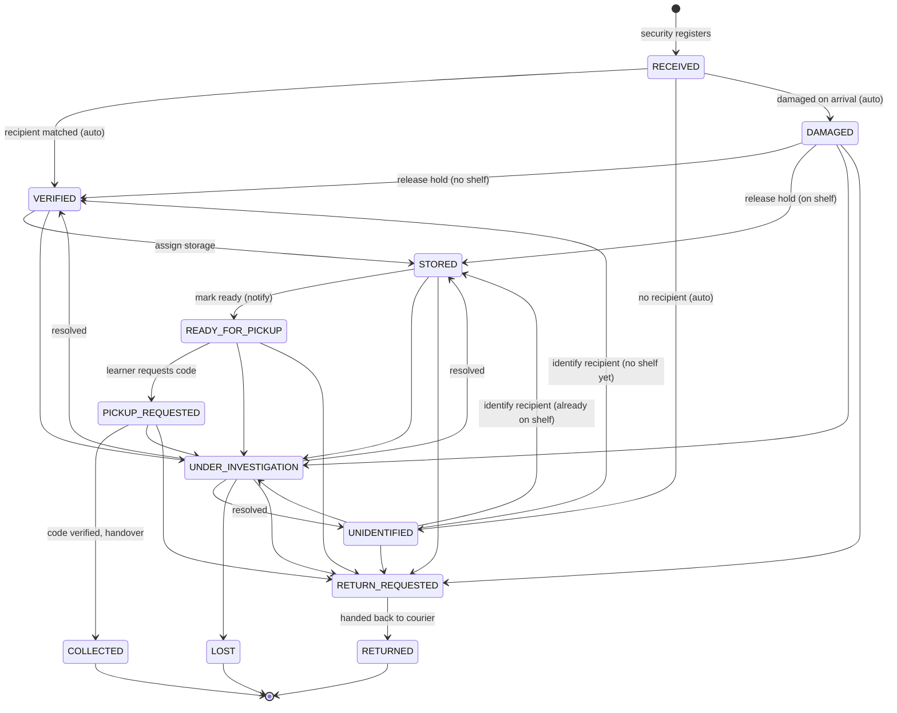

# 5. Package lifecycle and state management

## 5.1 Three separate ideas

| Concept | Field | Values | Changes when | Example |
|---|---|---|---|---|
| **Physical condition** | `packages.condition` (+ `condition_notes`) | `GOOD`, `DAMAGED` | Recorded at intake; it is a fact about the parcel and is never reset. | A crushed box released from the damage hold is `STORED` but still `DAMAGED`. |
| **Lifecycle status** | `packages.status` | 12 statuses below | Only through allowed transitions in `domain/state_machine.py`. | `READY_FOR_PICKUP` |
| **Overdue flag** | *derived*, not stored (`is_overdue` in API responses) | true/false | Computed at read time: status is `STORED`, `READY_FOR_PICKUP` or `PICKUP_REQUESTED` **and** `arrived_at` is more than `COLLECTION_DEADLINE_DAYS` ago. | An overdue package is still `READY_FOR_PICKUP` and can still be collected. |

Keeping overdue derived means changing the deadline in configuration immediately re-classifies
packages with no data migration, and it never contradicts the physical state.

## 5.2 State diagram

## 5.3 Transition table

`STAFF` = Security or Admin. "Dedicated" means the change needs extra input and is only possible
through its own endpoint, never through the generic `POST /packages/{id}/transitions`.

| From | To | Actor | Precondition (guard) | Endpoint / trigger | Notify learner |
|---|---|---|---|---|---|
| RECEIVED | VERIFIED | STAFF | recipient known | automatic at registration | "Package arrived" |
| RECEIVED | UNIDENTIFIED | STAFF | no recipient | automatic at registration (+ incident) | – |
| RECEIVED | DAMAGED | STAFF | – | automatic when condition = DAMAGED (+ incident) | "Arrived damaged" (if recipient known) |
| UNIDENTIFIED | VERIFIED | STAFF | recipient now set, no shelf | `POST /packages/{id}/recipient` (dedicated) | "Package arrived" |
| UNIDENTIFIED | STORED | STAFF | recipient now set, has shelf | `POST /packages/{id}/recipient` (dedicated) | – |
| UNIDENTIFIED | UNDER_INVESTIGATION | STAFF | – | transitions | – |
| UNIDENTIFIED | RETURN_REQUESTED | Admin | – | transitions (reason required) | – |
| DAMAGED | VERIFIED | STAFF | recipient, no shelf | transitions | – |
| DAMAGED | STORED | STAFF | recipient and shelf | transitions | – |
| DAMAGED | UNDER_INVESTIGATION | STAFF | – | transitions (reason) | – |
| DAMAGED | RETURN_REQUESTED | STAFF | – | transitions (reason) | "Being returned" |
| VERIFIED | STORED | STAFF | shelf assigned | `POST /packages/{id}/storage` (dedicated) | – |
| VERIFIED | UNDER_INVESTIGATION | STAFF | – | transitions (reason) | – |
| STORED | READY_FOR_PICKUP | STAFF | recipient and shelf | transitions, or storage with `mark_ready` | "Ready for pickup" |
| READY_FOR_PICKUP | PICKUP_REQUESTED | Learner (owner) | recipient | `POST /packages/{id}/pickup-request` (dedicated) | – |
| PICKUP_REQUESTED | COLLECTED | Security | valid code + learner ID | `POST /pickups/complete` (dedicated) | "Package collected" |
| STORED / READY / PICKUP_REQUESTED | UNDER_INVESTIGATION | STAFF | – | transitions (reason) or incident with `escalate` | – |
| STORED / READY / PICKUP_REQUESTED | RETURN_REQUESTED | Admin | – | transitions (reason) | "Being returned" |
| UNDER_INVESTIGATION | STORED | Admin | recipient and shelf | transitions | – |
| UNDER_INVESTIGATION | VERIFIED | Admin | recipient, no shelf | transitions | – |
| UNDER_INVESTIGATION | UNIDENTIFIED | Admin | no recipient | transitions | – |
| UNDER_INVESTIGATION | LOST | Admin | – | transitions (reason) | "Reported lost" |
| UNDER_INVESTIGATION | RETURN_REQUESTED | Admin | – | transitions (reason) | "Being returned" |
| RETURN_REQUESTED | RETURNED | STAFF | – | transitions | – |

Terminal states `COLLECTED`, `RETURNED` and `LOST` have **no outgoing transitions**, so a collected
package can never become ready again (tested by `test_collected_package_can_never_become_ready_again`).
Entering a terminal state sets `closed_at` and releases the shelf slot.

Repeated pickup requests while `PICKUP_REQUESTED` do not change status; they replace the code.

## 5.4 What is recorded for every transition

Inside the same transaction (`services/transitions.py`):

1. `packages.status`, `version + 1`, `updated_at`, and `ready_at` / `closed_at` when relevant, via a conditional UPDATE that requires the expected old status.
2. `package_status_history`: from, to, actor, reason, time.
3. `audit_logs`: action `package.<action>` (e.g. `package.mark_ready`) with from/to, reason and any released shelf.
4. A `PackageStatusChanged` event, published only after commit, which drives notifications.

## 5.5 How it is enforced

- The table is data (`TRANSITIONS`). `PackageStateMachine.check(source, target, role, ctx)` raises
  `InvalidTransitionError` (409) for an unknown edge, `PermissionDeniedError` (403) for the wrong role,
  and `TRANSITION_PRECONDITION_FAILED` (409) when a guard fails.
- Services never assign `package.status` directly; all changes go through `PackageTransitioner.apply`.
- `available(source, role, ctx)` computes the actions a user may take now. The API returns them as
  `available_actions`, and the frontend renders only those buttons, but the backend re-checks every request.
